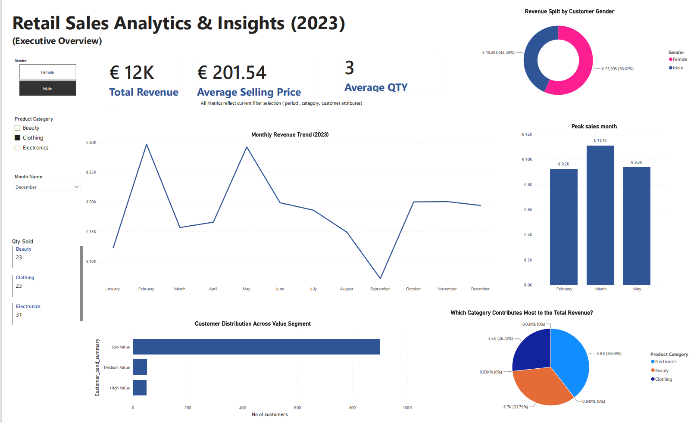
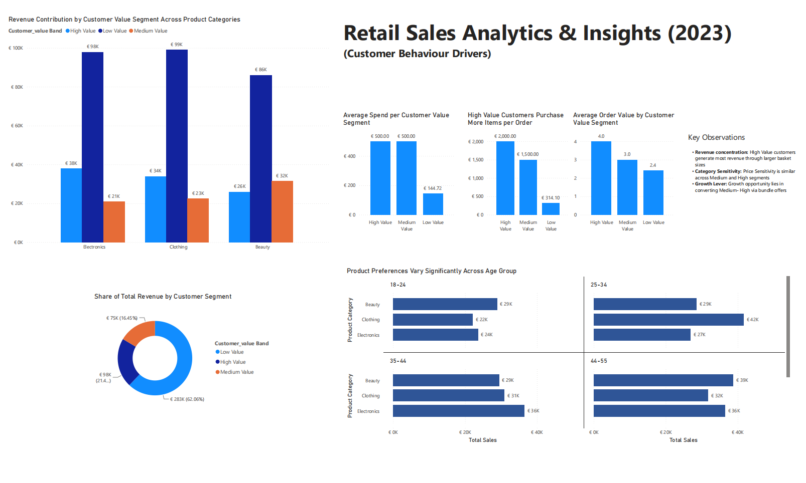
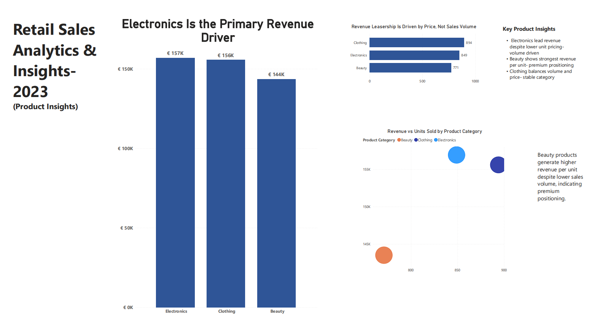

# Retail Sales Analytics & Insights (2023)

End-to-end Power BI commercial analytics solution evaluating multi-category retail performance, customer value segmentation, and demographic purchasing behaviors.

---

## 📄 Executive Report & Portfolio Assets
* **Interactive PDF Report:** [Download High-Res PDF Report](Retail_Sales_Insight_BI_2023.pdf)
* **Power Query ETL Pipelines:** 
  * `01_Retail_Sales_Fact_ETL.pq`
  * `02_Customer_Band_Summary.pq`
  * `03_Dim_Band_Summary.pq`
  * `04_Dim_Product_Category.pq`
* **DAX Formulas & Measures:** `DAX_Measures.dax`

---

## 📊 Dashboard Suite & Commercial Insights

### 1. Executive Overview

* **Performance Tracking:** Monitors revenue trends, average selling price (€201.54), and average transaction quantities.
* **Demographics & Seasonality:** Identifies peak sales periods; tracks gender contribution showing Male spend at 56.62% (€25,305) versus Female spend at 43.38% (€19,385).

### 2. Customer Behavior Drivers

* **Customer Value Banding:** Evaluates High, Medium, and Low value customer tiers.
* **Commercial Finding:** High-value customers drive **62.06% (€283K) of total revenue** due to larger basket sizes (4.0 items/order).
* **Demographic Preferences:** Highlights category adoption across age brackets, noting that Electronics peak in the 35–44 cohort at €36K.

### 3. Product Insights & Positioning

* **Volume vs. Price Analysis:** Electronics leads overall revenue (€157K, 849 units), while Beauty demonstrates high revenue-per-unit performance indicative of strong premium positioning.

### 4. Data Model Architecture

* **Star Schema Design:** Structured relational schema mapping fact tables to customer and product dimension attributes for optimized DAX filter propagation.

---

## 🛠️ Data Modeling & Interactivity
* **ETL Engine:** Engineered using Power Query (M) for conditional age grouping, revenue value banding, and data transformation.
* **Cross-Filtering:** Implemented data modeling allowing seamless propagation across dynamic timeline filters and slicers.
